  

<h2 align="center">Hi there 👋</h2>

  

  <a href="#what-i-build">What I build</a> ·
  <a href="#windows-phone-corner">Windows Phone corner</a> ·
  <a href="#stats">Stats</a>

  
  
  
  

I'm Vincenzo, an app developer from Bovalino, in Calabria. I write mobile apps, and I have a long-running habit of making old hardware do things it wasn't meant to do.

## What I build

Two radio apps, one per platform, written natively:

- **RadioVenereApp**: the Android app, in Kotlin.
- **RadioVenereAppSwift**: the iOS app, in Swift.

Outside those I keep a NAS running Docker, render VFX in Blender, and collect retro computing gear.

  

Currently learning: Flutter, and LEGO SPIKE Prime in Python.

## Windows Phone corner

  
   
  Live tiles, flipping every few seconds like the real thing.

I still like Windows Phone. I work on apps for Windows Phone 8.1 (Silverlight and WinRT) and Windows 10 Mobile, using Visual Studio 2015, and I'm always curious how far an old Lumia with 512 MB of RAM can go.

Microsoft ended support a long time ago, so this is a hobby. Nothing here gets store updates.

<strong>What I'm poking at</strong> on Windows Phone right now.

 

- A full Gmail client that runs on the phone itself, on Windows Phone 8.1
- People Hub integration inside a WinRT app
- Silverlight XAML layouts and the Windows Phone Toolkit
- Writing XAML outside Visual Studio and checking it with screenshots
- Interop unlock on Lumia devices
- Porting games to devices with 512 MB of RAM (Fallout 1/2 Community Edition is the test case)

<strong>Useful tools</strong> for Lumia phones.

 

- [WPinternals](https://github.com/ReneLergner/WPinternals): flashing and unlock tool for Lumia phones.

## Stats

  
  

  

  

  <picture>
    <source media="(prefers-color-scheme: dark)" srcset="https://raw.githubusercontent.com/vincenzosco/vincenzosco/output/github-snake-dark.svg">
    <source media="(prefers-color-scheme: light)" srcset="https://raw.githubusercontent.com/vincenzosco/vincenzosco/output/github-snake.svg">
    
  </picture>

  

